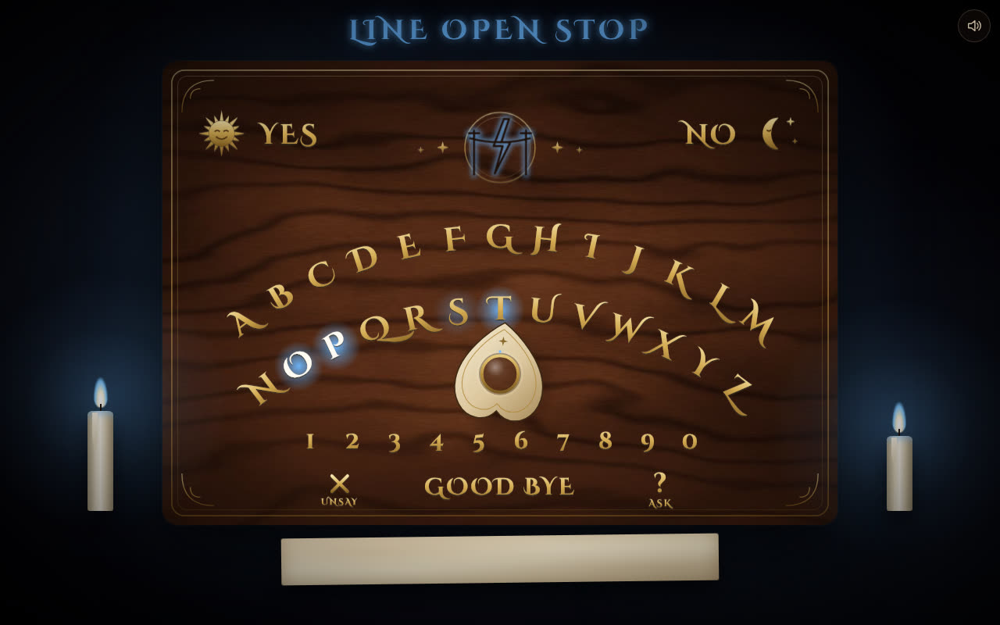
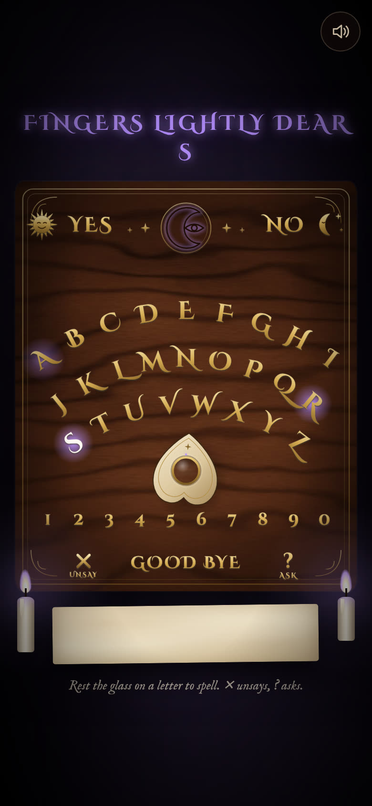

# Spirit Board

A candlelit talking board where AI spirits answer. You spell a question by
dragging the planchette from letter to letter. When you ask, your ink soaks
into the paper, the planchette pulls away from your fingers, and a spirit
spells its reply on its own. The idea comes from Maxime Rivest's Tom Riddle
diary for the reMarkable.

<p align="center">
  
  
</p>

There is no typing anywhere. Even the word that unlocks the board is spelled
with the planchette.

## How to play

- **Unlock the board.** A new device sees a dark board. Spell the secret word
  and rest the glass on **? ASK**. A wrong word sends the planchette to
  **NO**. Each device stays unlocked for 30 days.
- **Summon a spirit.** Touch the planchette. The candles gutter out and one of
  12 spirits arrives, with its own color, sigil, sound and way of moving. It
  spells a greeting.
- **Spell a question.** Drag the planchette and rest the glass on a letter
  for about a second. When the ring fills, the letter is written on the slip.
  Letters run together the way they do on a real board (`WHATISYOURNAME`),
  and the spirit reads them fine. To spell a double letter, nudge off the
  letter and back on.
  - **✕ UNSAY** erases the last letter.
  - **? ASK** sends the question.
  - **YES** or **NO** on an empty slip answers the spirit's own question
    straight away.
- **Find out who it is.** Ask `WHOAREYOU`. When the spirit spells its name,
  the name is engraved on the brass plate under its sigil.
- **End the séance.** Rest the glass on **GOOD BYE**. Spirits also leave on
  their own if you're rude. An end card shows who you met, ready to be the
  last shot of a video. Touch the card, then the planchette, to summon
  someone new.

## Run it on your computer

You need [Node.js](https://nodejs.org) 22.12 or newer.

```bash
npm install
cp .dev.vars.example .dev.vars   # then edit it
npm run dev                      # open the URL it prints
```

In `.dev.vars`:

- `BOARD_WORD` is the word that unlocks the board. Use letters or digits;
  5–8 letters works well.
- `COOKIE_SECRET` can be any long random string.
- `MOCK_SPIRIT=1` plays with canned replies and needs no API key. This is good
  for trying it out.
- For real spirits, set `ANTHROPIC_API_KEY` to a key from the
  [Anthropic Console](https://console.anthropic.com) and set `MOCK_SPIRIT=0`.

To play on your phone over Wi-Fi, run `npm run dev -- --host` and open the
network URL it prints.

## Put it online for your friends (free)

The app runs on a Cloudflare Worker, which is free at this size.

1. Create a free account at [cloudflare.com](https://dash.cloudflare.com/sign-up).
2. Log in from this folder:

   ```bash
   npx wrangler login
   ```

3. Store the three secrets. Each command asks you to paste a value:

   ```bash
   npx wrangler secret put BOARD_WORD
   npx wrangler secret put COOKIE_SECRET
   npx wrangler secret put ANTHROPIC_API_KEY
   ```

4. Deploy:

   ```bash
   npm run deploy
   ```

The command prints a link like `https://spirit-board.<you>.workers.dev`. Send
your friends the link and the board word. To change the word later, run
`npx wrangler secret put BOARD_WORD` again.

## What it costs

The spirits run on **Claude Haiku 5.5**. Replies are a few words, so one
question costs roughly $0.0002, and 1,000 questions cost about 20 cents. The
spirit's instructions are cached between questions, which cuts the cost
further.

Safety nets:

- **Spend limit (do this first).** In the Anthropic Console, set a monthly
  spend limit under *Settings → Limits*. That's the hard cap.
- **Rate limits.** Each device can ask about 15 questions a minute. Wrong
  board words are limited to 5 tries a minute per network. You can change
  both under `ratelimits` in `wrangler.jsonc`.
- **Choosing a model.** The model is one setting, `SPIRIT_MODEL` in
  `wrangler.jsonc`. Haiku 5.5 suits replies this short.

## Tune the spirits

Each spirit has two halves:

- `shared/presence.ts` holds what everyone sees: name, epitaph, color, sigil,
  motion style, sound, and the opening and farewell lines.
- `worker/spirits.ts` holds what only the server knows: voice, secret, how it
  dodges questions too big for a board, and 5–6 example exchanges. The
  examples set the tone more than anything else.

The rules every spirit follows are in `BASE_RULES` in the same file: one to
five words, YES or NO when it fits, leave when insulted, and gentle
guardrails.

To hear how they actually sound before you film:

```bash
npm run sample                                  # every spirit, 20 questions (a few cents)
npm run sample -- --spirit pip --effort medium  # one spirit, more thinking
```

This asks each spirit the same 20 questions through the real model and prints
the replies side by side. It flags any reply that breaks the board's format.
It reads `ANTHROPIC_API_KEY` from your shell or from `.dev.vars`.

To add a spirit, add it to both files. The unit tests check that every spirit
is complete and that its lines fit on the board.

## How it's built

- **Front end** (`src/`) is plain TypeScript and SVG built with Vite. It has
  no framework.
  - The board layouts are data (`src/board/layout.ts`): two arcs of letters
    on wide screens, three arcs on phones held upright.
  - The wood is painted procedurally.
  - The planchette's glass magnifies the letters underneath it.
  - Every sound is synthesized with Web Audio, so there are no audio files.
- **Server** (`worker/`) is a Cloudflare Worker with four endpoints: `/api/me`,
  `/api/enter`, `/api/ask`, and the static site. It checks the signed cookie,
  validates and cleans everything it receives, and calls Claude through
  `@anthropic-ai/sdk`.
- **Shared** (`shared/`) holds the rules for what the board can spell and the
  spirits' public data.

## Tests

```bash
npm run typecheck
npm test            # unit tests: layout, dwell, text rules, spirits, API (with a fake Claude)
npm run test:e2e    # full séances in a real browser at phone and laptop sizes (canned spirits)
```

---

*For entertainment. The spirits are fictional characters played by an AI.
"Ouija" is a trademark of Hasbro, and this project is not affiliated with
it.*
